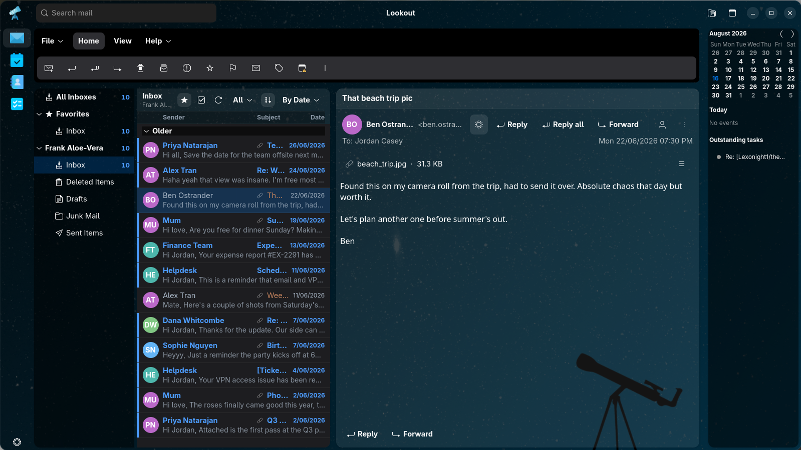

<p align="center">
  
</p>

# Lookout

A native GNOME mail, calendar, people, and tasks client written in Rust, built on GTK 4, libadwaita, and WebKitGTK. Lookout is a reimplementation of Microsoft Outlook as a desktop application: mail over IMAP/SMTP (or an optional Microsoft Graph transport), calendars over CalDAV or Microsoft Graph, contacts over CardDAV or Microsoft Graph, and tasks over CalDAV VTODO, Google Tasks, Microsoft To Do, or local lists. Microsoft 365 properties such as categories, follow-up flags, rules, and automatic replies sync natively through Microsoft Graph. Accounts come from **GNOME Online Accounts**, or you can add any IMAP/SMTP server by hand; desktop address books are available through Evolution Data Server where present.

[](https://ko-fi.com/P5P21M7MBS)


**Platform:**
[](LICENSE)
[](https://github.com/gavindi/lookout)

**Packages:**
[](https://github.com/gavindi/lookout/releases/latest)
[](https://github.com/gavindi/lookout/releases/latest)
[](https://github.com/gavindi/lookout/releases/latest)
[](https://github.com/gavindi/lookout/releases/latest)


## Features

How far each area is towards Outlook parity, counted from the feature-by-feature tables in [OUTLOOK_PARITY.md](OUTLOOK_PARITY.md). ✅ complete, 🟡 partial (exists, but narrower than Outlook), ❌ not yet, ⛔ not possible over the open protocols or out of scope; completion is the share of an area's features that are complete.

| Area | ✅ | 🟡 | ❌ | ⛔ | Completion | What you get | Not yet |
|---|:-:|:-:|:-:|:-:|:-:|---|---|
| **Mail** | 37 | 5 | 2 | 2 | 80% | • IMAP with live updates (IDLE) across accounts<br>• Unified All Inboxes, folder tree and Favorites<br>• Conversations<br>• Sandboxed reading pane with a dark/light view<br>• Full-text search with filters, refiners and history<br>• Categories, follow-up flags, pin and snooze<br>• Focused Inbox and @mentions<br>• Quick Steps, Sweep, Search Folders, Ignore conversation<br>• Rules (local, Microsoft 365 or Sieve)<br>• Automatic replies<br>• Junk and phishing reporting<br>• Undo for every message action<br>• Drag to folders, categories or out as `.eml`<br>• TNEF, print, unsubscribe, read receipts | `.msg` files, delivery receipts, translation |
| **Compose** | 16 | 3 | 3 | 1 | 70% | • New, reply, reply all, forward (or as attachment)<br>• Rich editor: images, tables, emoji, file drop<br>• Follows dark mode, with "View in Light Mode"<br>• Address autocomplete and address book<br>• Contact lists that expand<br>• Identities, signatures and My Templates<br>• Undo send and schedule send<br>• Importance and sensitivity<br>• Spell checking<br>• Draft autosave and reopen<br>• Attachment reminder<br>• Pop-out window | @mention insertion, encryption and signing, mail merge |
| **Calendar** | 30 | 4 | 1 | 0 | 86% | • CalDAV, or native Microsoft 365<br>• Day, Work week, Week, Month, Schedule, List and split views<br>• Drag to move, copy and resize<br>• Recurrence, editable per occurrence<br>• Categories and time zones<br>• Working hours and week start<br>• Meeting invitations, replies and tracking<br>• Proposed times and forwarding<br>• Scheduling Assistant with free/busy<br>• Join buttons for online meetings<br>• Holiday calendars and webcal subscriptions<br>• `.ics` import/export<br>• Birthday calendar<br>• Calendar groups and sharing<br>• Event attachments<br>• Event alerts | Room suggestions, weather |
| **People** | 11 | 1 | 0 | 0 | 92% | • CardDAV or native Microsoft 365 contacts with full editing<br>• Groups and favourites<br>• Photos, anniversaries, IM, websites, custom fields<br>• "File as"<br>• Profile card from messages and attendee chips<br>• `.vcf` and Outlook CSV import/export<br>• Merge duplicate contacts<br>• Desktop address books from GNOME Contacts and Evolution (where available)<br>• Microsoft 365 directory and LDAP lookup in compose and the recipient picker | People-screen Directory group; Settings opt-in and LDAP dialogs |
| **Tasks** | 10 | 0 | 1 | 1 | 83% | • CalDAV, Google Tasks, Microsoft To Do and local lists<br>• My Day and Flagged email<br>• Due dates, priorities, categories, notes<br>• Reminders and recurrence<br>• Create, rename and delete lists<br>• Create a task from a message | Subtasks |
| **Accounts / Microsoft 365** | 6 | 0 | 2 | 0 | 75% | • GNOME Online Accounts<br>• Any IMAP/SMTP account by hand<br>• Passwords in the keyring<br>• Microsoft 365 mail with OAuth2<br>• Native Microsoft 365 calendar, contacts and To Do<br>• Categories, flags, Focused Inbox, rules and automatic replies synced with Outlook<br>• Optional Graph mail transport (experimental) | Exchange on-premises (EWS), POP3 |
| **Security** | 6 | 0 | 2 | 1 | 67% | • Sandboxed rendering<br>• Remote content blocked until allowed<br>• SPF/DKIM/DMARC banners<br>• Lookalike-sender warnings<br>• External-sender tag<br>• Real link destinations<br>• Report Phishing | S/MIME and OpenPGP |
| **Desktop and extras** | 4 | 4 | 4 | 0 | 33% | • Outlook-style ribbon, Classic or Simplified<br>• Home, Send / Receive, Folder, View and Help tabs<br>• Themes, accent colour and window background<br>• Remappable shortcuts<br>• Tray icon and dock badge<br>• Lookout dashboard<br>• Optional AI assistant | An Outlook keymap preset, PST import, sticky notes, Translate/Immersive Reader |
| **Total** | **120** | **17** | **15** | **5** | **76%** | | |

See [OUTLOOK_PARITY.md](OUTLOOK_PARITY.md) for the feature-by-feature gap analysis against Outlook and the phased plan to close it, and [SCAFFOLD.md](SCAFFOLD.md) for the architecture.



## Project layout

```
.
├── assets/                   # App icons and screenshots
├── source/                   # Rust Cargo workspace (the desktop app)
│   ├── crates/
│   │   ├── core/             # Domain types, threading, mailbox roles, rules, Outlook interop
│   │   ├── goa/              # GNOME Online Accounts D-Bus discovery + credentials
│   │   ├── eds/              # Evolution Data Server client for desktop address books + directory lookups
│   │   ├── mail/             # IMAP/SMTP account-session actor + SQLite cache
│   │   ├── dav/              # CalDAV/CardDAV client + iCalendar/vCard/recurrence handling
│   │   ├── graph/            # Microsoft Graph client + calendar, contacts, To Do and mail backends
│   │   ├── imap-proto/       # Vendored imap-proto fork (UTF-8 envelope fix, patched via Cargo)
│   │   ├── async-imap/       # Vendored async-imap fork (COMPRESS stream swap, buffer perf fix)
│   │   └── app/              # GTK4/libadwaita UI (lookout binary)
│   ├── data/                 # .desktop file, AppStream metainfo, icons, GSettings schema, GResource bundle, themes
│   ├── test-fixtures/        # Sample .eml/.ics fixtures plus captured Outlook interop artefacts used by tests
│   ├── flatpak/              # Flatpak manifest (built by CI)
│   └── snapcraft.yaml        # Snap packaging manifest
├── build.sh                  # Builds the Rust workspace (optionally packages a .deb)
├── MARKETING.md              # Marketing copy and feature walkthrough
├── OUTLOOK_PARITY.md         # Outlook gap analysis, interop reference, and roadmap
├── RIBBON_CONSISTENCY.md     # Ribbon/compose-tab implementation plan
├── SCAFFOLD.md               # Architecture guide
└── CHANGELOG.md              # Version history
```

## Prerequisites

- Rust (stable) — via [rustup.rs](https://rustup.rs)
- Optional: Evolution Data Server, for desktop address books and directory lookups
- GTK 4, libadwaita, and WebKitGTK development packages (checked via `pkg-config`):

```bash
# Debian/Ubuntu
sudo apt-get install libgtk-4-dev libadwaita-1-dev libwebkitgtk-6.0-dev libglib2.0-dev pkg-config
```

To run the app you also need a GNOME desktop session with at least one **mail-enabled** account configured in *Settings → Online Accounts* (an empty state otherwise deep-links you to `gnome-control-center online-accounts`), or you can add an IMAP/SMTP account directly from Lookout's account dialog.

## Build and run

```bash
# Build the Rust workspace
./build.sh                # release build (default)
./build.sh --debug        # debug build
./build.sh --deb          # release build + .deb package (requires cargo-deb)

# Or just the desktop app
cd source
cargo build               # binary at source/target/debug/lookout
cargo run                 # build and launch
```

`./build.sh` prints the resulting binary path; a release build lands at `source/target/release/lookout`.

## Testing

```bash
cd source

# Unit tests (whole workspace). Includes lookout-eds's fake-EDS D-Bus tests,
# which start their own private dbus-daemon (needs `dbus-daemon` on PATH)
cargo test --workspace

# Fake-GOA D-Bus test on an isolated session bus (real D-Bus-wire coverage
# of account discovery and credential fetching, no live GNOME session needed)
dbus-run-session -- cargo test -p lookout-goa --test fake_goa

# GreenMail IMAP/SMTP integration test - requires Docker, skipped by default
cargo test -p lookout-mail --features test-utils --test imap_integration -- --ignored

# Linting / formatting
cargo clippy --workspace --all-targets -- -D warnings
cargo fmt --all -- --check
```

CI (`.github/workflows/ci.yml`) runs fmt, clippy, unit tests, the fake-GOA D-Bus test, the Docker-gated GreenMail test, and a full build; `.github/workflows/release.yml` packages `.deb`/`.rpm` artifacts and builds the Flatpak and Snap bundles for each release.

## Roadmap

Lookout tracks its remaining distance to Outlook in [OUTLOOK_PARITY.md](OUTLOOK_PARITY.md): a feature-by-feature gap analysis (mail, compose, calendar, people, tasks, accounts, security, desktop), an Outlook interop reference (headers, iCalendar properties, Graph endpoints, file formats, keyboard maps), and a phased roadmap through the remaining Outlook parity work. That document is kept current as features land.

## License

GPL-3.0-or-later.

[](https://buymeacoffee.com/gavindi)
